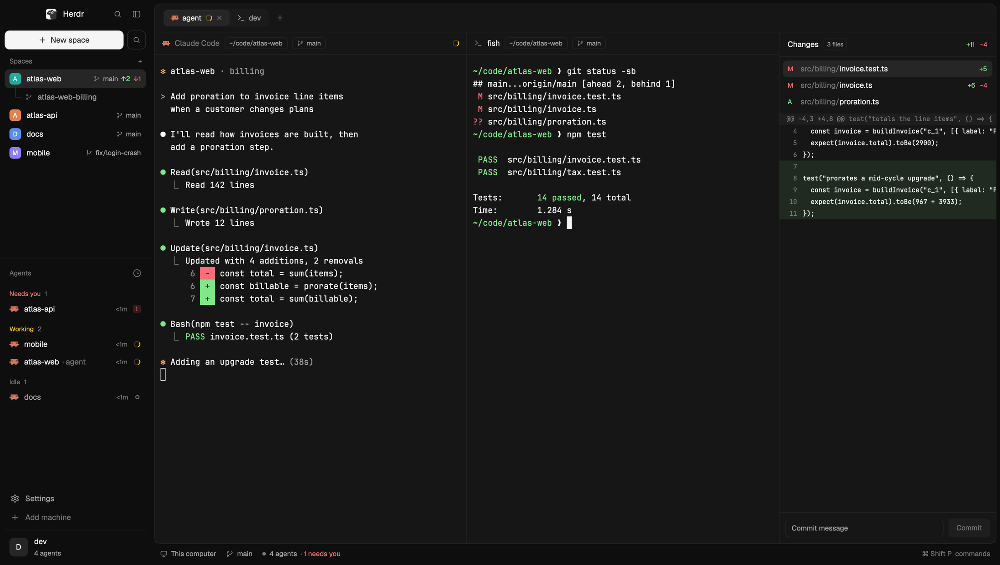

# 0oz design

A calm, neutral dark shell for Herdr in the spirit of shadcn's `dashboard-01` and coss ui. The sidebar and the window share one near-black colour, and the work area is a single rounded, thinly bordered card inset into the window. A lone terminal sits flush inside that card with no frame of its own. Several terminals sit side by side, split by a 1px hairline instead of cards, and the focused one is marked in its header rather than by a bright ring. Only grays and the status colours are used.

## What you see

Left to right, on a `chrome` (#0e0e0e) window:

- **Sidebar, 256px, `chrome`, no divider.** Top to bottom:
  - Brand bar, 48px: the Herdr logo (22px), "Herdr" in semibold 14px, a search button and a sidebar toggle (28px ghost buttons). On macOS it starts 76px from the left to clear the traffic lights.
  - A solid "New space" button (32px high, 8px radius, `solid` #f5f5f5 with `solid_foreground` ink) and a 32px outlined search button beside it.
  - "Spaces +" in a muted 11.5px label.
  - Space rows grouped by machine, each 32px high with a 20px rounded initial tile, the name (medium weight when active), then a branch icon, branch name and ahead/behind counts in 11.5px muted text. Worktree spaces nest under their repo's space on a 1px guide line with an elbow connector.
  - The shipped `agents` list below it.
  - Footer, 132px: Settings and Add machine rows (32px, 8px radius, icon 15px), a 1px divider, then an account chip: a 32px initial tile, the home folder's name and "N agents".
- **Work area**, 6px in from the window edge: one card with `background` (#161616) fill, 12px radius, 1px `border` (#242424) outline and a small shadow. Inside it, top to bottom:
  - Tab bar, 48px, bottom hairline. Tabs sit in a pill (`popover` #1b1b1b, 8px radius, 2px padding). The active tab is `selected` (#262626) with an `input` (#2c2c2c) outline, medium weight and a close x. A `+` icon button follows the pill. On the right are outlined "Files" and "Changes" toggle buttons (28px, 8px radius).
  - Terminal area, edge to edge, text inset by `terminal_padding` [10, 8]. The Files/Changes panel, 368px (280 to 900), opens on the right, separated by the same 1px hairline. It is flat: no border or rounded corners of its own, a 42px header with a bottom hairline, then its list.
- **Status bar**, 26px, under the card, no background of its own: machine, branch, agent count, "needs you" count, and the palette shortcut on the right.

Colours (theme `0oz`): background #161616, canvas #111111, chrome #0e0e0e, surface #151515, popover #1b1b1b, raised #1e1e1e, hover #1f1f1f, selected #262626, border #242424, input #2c2c2c, foreground #f5f5f5, muted #a3a3a3, dim #7a7a7a, accent #737373. Status: working #fbbf24, blocked #f87171, done #34d399, idle #737373.

## How it behaves

- **Working:** a spinning ring in the tab and in the pane header (and a spinner on the agent row). **Blocked:** a red dot on the tab, a red "Needs you" badge in the pane header. **Done:** a green dot on the tab and in the header. **Idle:** nothing extra.
- **One terminal:** no header, border, radius or focus ring. The tab already shows its icon and name.
- **Two or more:** every pane gets a 38px header with the agent icon, the name (foreground when the pane has the keyboard, `dim` otherwise), outlined badges for the folder and the git branch, and the status. Hovering a header shows split right, split down, zoom and close. Panes are squared off and divided by a 1px `border`-coloured line. Clicking a header focuses its pane.
- **Tabs:** click selects, double-click renames, right-click opens the tab menu, dragging one onto another reorders, the mouse wheel steps through them, `+` opens the new-terminal menu. The Files/Changes choice is remembered per space.
- **Sidebar:** the New space button opens the `oz-new-space` dialog (folder with a native Browse picker, agent, optional branch). Without a branch it runs `space.new {folder, argv}`; with one it opens the shipped `worktree` dialog, which creates the checkout and the space. The search buttons open the picker, the search buttons open the picker, the toggle collapses the sidebar to 44px (icons only).
- Keys are untouched. Suggested additions: `ctrl-shift-5` for `pane.split:right` and `ctrl-shift-'` for `pane.split:down`.

## Built from

- Layout `0oz-design` (`layouts/0oz-design.json`), root row: `background` chrome, `theme` `{light: paper, dark: 0oz}`, `terminal_padding` [10, 8], `titlebar` none, `traffic_lights` [12, 16], no divider.
  - `sidebar` column 256px, min 44, max 480, `chrome`, not resizable: `brand` block 48px (`oz-chrome`, `window_drag`), `sidebar-lists` column holding `spaces` (`oz-spaces`, weight 1, min 90) and `agents` (shipped `agents`, weight 1, min 90), then `sidebar-footer` block 132px (`oz-chrome` with props `{footer: true}`).
  - `work` column, padding 6, gap 4, not resizable, holding `inset` column (`background` background, radius 12, border 1px `border`, shadow `sm`) and the `status` block 26px (`oz-status`).
  - `inset` holds `tabs` block 48px (`oz-tabs`, `window_drag`) and `work-body` row (padding 0, gap 1, background `border`).
  - `work-body` holds `main` (background `border`; content `{tab: "active", pane: {...}}`) and `panel` column 368px, hidden by default, with a `panel-body` stack of the `oz-files` and `oz-changes` blocks.
  - `main`'s pane frame: `background` background, `border` width 0, `focus` width 0, `radius` 0, `gap` 1, `lone` false, header `{content: {mod: "oz-pane"}, height: 38, position: "top", reveal: "always"}`. The 1px lines between panes and between the terminal and the panel are the `border` background of `main` and `work-body` showing through the gaps.
- Theme `0oz` (`themes/0oz.json`): the colours above plus a 16-colour ANSI palette.
- Mods, all clones of shipped Herdr mods except `oz-new-space` (new): `oz-tabs` (from `tabs`), `oz-pane` (from `pane`), `oz-chrome` (from `workspace-chrome`), `oz-status` (from `workspace-status`), `oz-spaces` (from `spaces`), `oz-files` (from `files`), `oz-changes` (from `changes`). The last two differ from the shipped mods in one line each: their root no longer draws its own `rounded(10)` border and card.
- Functions and commands used: `spaces`, `agents`, `panes`, `theme`, `shared`, `setShared`, `layout`, `window`, `props`, `home`, `updates`, `openOverlay`, `run` with `space.new`, `tab.*`, `pane.*`, `layout.*`, `app.settings`, `mod.open`.
- Shipped things it relies on: mods `agents`, `new-menu`, `menu`, `picker`; assets `frame/welcome/herdr.png`, `mods/workspace-chrome/{branch,plus,search,spinner}.svg`, `mods/pane/close.svg`, `mods/files/file.svg`, `mods/changes/changes.svg`; theme `paper` for light mode.

## Watch out

- **`oz-spaces` runs programs.** It calls `git` (`status --porcelain=v2 --branch`, `rev-parse`) in each space's folder and `hc machine ls --json`, both through `exec` and `hc`. It makes no network requests and reads nothing outside the spaces' folders.
- Copy `themes/0oz.json` to `themes/` as well as the layout and the mods. Without it the dark half of the theme falls back.
- A layout file edited while the window is hidden may not repaint until you nudge the zoom (`app.zoom_in`, then `app.zoom_out`).
- The shipped `files` and `changes` mods draw their own rounded, bordered card. Inside this layout's card that reads as a card in a card, which is why `oz-files` and `oz-changes` exist. Don't swap the shipped ones back in.
- A single pane has no header by design (`lone: false`). Set `lone` to true and the card frame returns, along with the header.
- If a pane's `background` and the inset card's `background` differ, a visible card-in-card edge returns. Keep both on `background`.
- The footer's account chip shows the first letter of the home folder's name, for example `oz`.
- Mod names were chosen to avoid clashes with other layouts. If a name is taken, rename the folder, the layout's `mod` references and the `mods/<name>/` asset paths inside it.

## Done when

- `herdr-app check mods/<name>` passes for `oz-new-space`, `oz-tabs`, `oz-pane`, `oz-chrome`, `oz-status`, `oz-spaces` and `oz-files` (`oz-changes` cannot be checked headlessly, the shipped `changes` panics in `check` too, so confirm it by opening the panel), and `herdr-app status` lists no errors after `layout.switch {name: "0oz-design"}`.
- With one terminal, the window shows a single rounded card with no inner border and no pane header.
- After `pane.split {direction: "right"}`, both panes have a 38px header and are separated by a 1px line, with no rounded corners and no gap.
- The focused pane's title is #f5f5f5 and the other's is #7a7a7a.
- Opening Files or Changes from the tab bar shows a 368px panel on the right, divided from the terminal by a 1px line, with no border or rounded corner of its own.
- The sidebar shows the solid "New space" button, 32px space rows with initial tiles, and the Settings, Add machine and account rows at the bottom.
